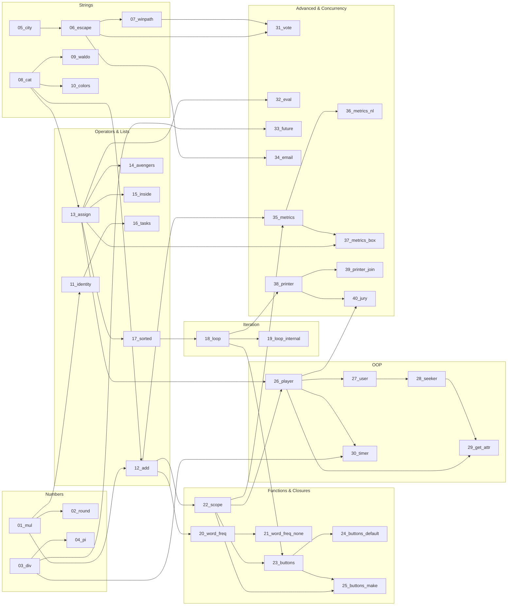

# Python Brain Teasers

Code examples from the book [Python Brain Teasers](https://pragprog.com/titles/d-pybrain/python-brain-teasers/) by Miki Tebeka.

The files are sorted in learning order using a directed acyclic graph (DAG) saved in [`dag.json`](dag.json). Each teaser builds on concepts introduced in earlier files.

---

## Quickstart

### Interactive Terminal Quiz

Test your Python intuition with an interactive terminal quiz. It shows snippets one by one, fuzzy-matches your answers against runtime output, and tallies your final score.

On any failed attempt, an interactive IPython terminal opens automatically with the teaser's code pre-executed so you can inspect variables and explore behavior. Type `exit` or press `Ctrl+D` to return to the quiz.

For a fair game, the only reference to use is the official [Python documentation](https://docs.python.org/3/).

```bash
# Run all teasers in learning order
uv run quiz.py

# Start from a specific puzzle or run just one
uv run quiz.py --start 10
uv run quiz.py --teaser 23

# Shuffle for flashcard practice
uv run quiz.py --random

# Disable launching IPython on failed attempts
uv run quiz.py --no-ipython
```

### Run Snippets Directly

Run any teaser with [uv](https://docs.astral.sh/uv/):

```bash
uv run python teasers/01_mul.py
uv run python teasers/23_buttons.py
```

Run checks:

```bash
# Linting
uv run ruff check

# Type checking
uv run pyrefly check
```

---

## Learning Order (DAG)

Concepts flow from basic numbers and strings up to closures, classes, and concurrency:



---

## Teasers List

| # | File | Topic | Depends On |
|---|------|-------|------------|
| 01 | [`01_mul.py`](teasers/01_mul.py) | Floating point arithmetic | - |
| 02 | [`02_round.py`](teasers/02_round.py) | Rounding behavior | `01_mul.py` |
| 03 | [`03_div.py`](teasers/03_div.py) | Division semantics | - |
| 04 | [`04_pi.py`](teasers/04_pi.py) | Unicode variable identifiers | `03_div.py` |
| 05 | [`05_city.py`](teasers/05_city.py) | Unicode strings and character counting | - |
| 06 | [`06_escape.py`](teasers/06_escape.py) | String escape sequences | `05_city.py` |
| 07 | [`07_winpath.py`](teasers/07_winpath.py) | Backslashes in string literals | `06_escape.py` |
| 08 | [`08_cat.py`](teasers/08_cat.py) | String slicing with steps | - |
| 09 | [`09_waldo.py`](teasers/09_waldo.py) | Substring search and truthiness | `08_cat.py` |
| 10 | [`10_colors.py`](teasers/10_colors.py) | String literals in collections | `08_cat.py` |
| 11 | [`11_identity.py`](teasers/11_identity.py) | Object identity vs equality | `01_mul.py` |
| 12 | [`12_add.py`](teasers/12_add.py) | Operator behaviors and type annotations | `01_mul.py`, `08_cat.py` |
| 13 | [`13_assign.py`](teasers/13_assign.py) | List slice assignment | `08_cat.py` |
| 14 | [`14_avengers.py`](teasers/14_avengers.py) | Multiple assignment evaluation | `13_assign.py` |
| 15 | [`15_inside.py`](teasers/15_inside.py) | Augmented assignment with lists | `13_assign.py` |
| 16 | [`16_tasks.py`](teasers/16_tasks.py) | Tuple ordering in priority queues | `11_identity.py` |
| 17 | [`17_sorted.py`](teasers/17_sorted.py) | Iterators and sorting | `13_assign.py` |
| 18 | [`18_loop.py`](teasers/18_loop.py) | For-loop target variable binding | `17_sorted.py` |
| 19 | [`19_loop_internal.py`](teasers/19_loop_internal.py) | Iteration protocol mechanics | `18_loop.py` |
| 20 | [`20_word_freq.py`](teasers/20_word_freq.py) | Function default arguments | `12_add.py` |
| 21 | [`21_word_freq_none.py`](teasers/21_word_freq_none.py) | Alternative default argument patterns | `20_word_freq.py` |
| 22 | [`22_scope.py`](teasers/22_scope.py) | Lexical scope and nested functions | `12_add.py` |
| 23 | [`23_buttons.py`](teasers/23_buttons.py) | Closures in loops | `18_loop.py`, `22_scope.py` |
| 24 | [`24_buttons_default.py`](teasers/24_buttons_default.py) | Binding closure values with defaults | `23_buttons.py` |
| 25 | [`25_buttons_make.py`](teasers/25_buttons_make.py) | Binding closure values with helper functions | `22_scope.py`, `23_buttons.py` |
| 26 | [`26_player.py`](teasers/26_player.py) | Class vs instance attributes | `13_assign.py`, `22_scope.py` |
| 27 | [`27_user.py`](teasers/27_user.py) | Attribute naming conventions and access | `26_player.py` |
| 28 | [`28_seeker.py`](teasers/28_seeker.py) | Attribute access intercept methods | `27_user.py` |
| 29 | [`29_get_attr.py`](teasers/29_get_attr.py) | Attribute lookup order | `26_player.py`, `28_seeker.py` |
| 30 | [`30_timer.py`](teasers/30_timer.py) | Context managers and exception handling | `03_div.py`, `26_player.py` |
| 31 | [`31_vote.py`](teasers/31_vote.py) | Regular expression matching | `06_escape.py`, `07_winpath.py` |
| 32 | [`32_eval.py`](teasers/32_eval.py) | Dynamic code evaluation with eval() | `13_assign.py` |
| 33 | [`33_future.py`](teasers/33_future.py) | Date and time boundaries | `03_div.py` |
| 34 | [`34_email.py`](teasers/34_email.py) | Module naming and imports | `06_escape.py` |
| 35 | [`35_metrics.py`](teasers/35_metrics.py) | Decorators and variable scope | `12_add.py`, `22_scope.py` |
| 36 | [`36_metrics_nl.py`](teasers/36_metrics_nl.py) | Rebinding variables with nonlocal | `35_metrics.py` |
| 37 | [`37_metrics_box.py`](teasers/37_metrics_box.py) | Container state across scopes | `13_assign.py`, `35_metrics.py` |
| 38 | [`38_printer.py`](teasers/38_printer.py) | Thread execution and lifecycle | `18_loop.py` |
| 39 | [`39_printer_join.py`](teasers/39_printer_join.py) | Thread synchronization | `38_printer.py` |
| 40 | [`40_jury.py`](teasers/40_jury.py) | Multiprocessing and global variables | `26_player.py`, `38_printer.py` |

---

## License

Code is licensed under the [Apache License, Version 2.0](https://opensource.org/licenses/Apache-2.0).
